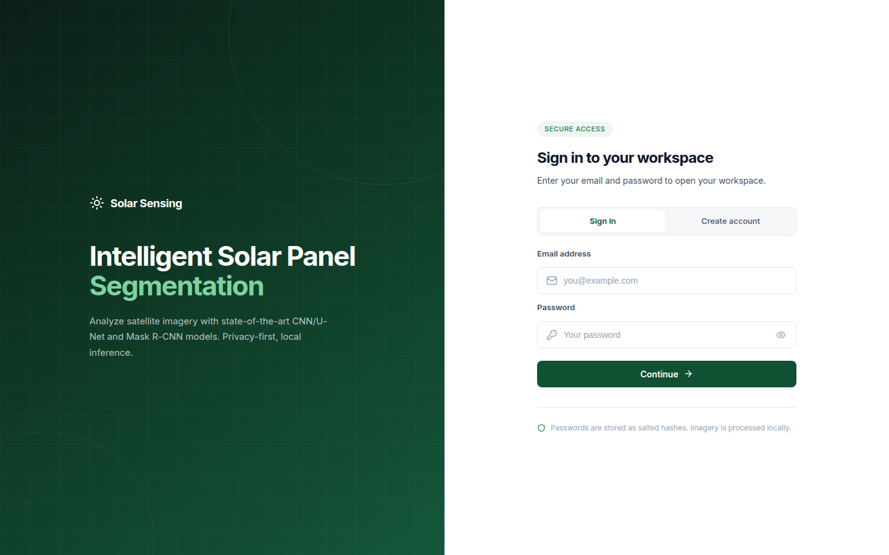
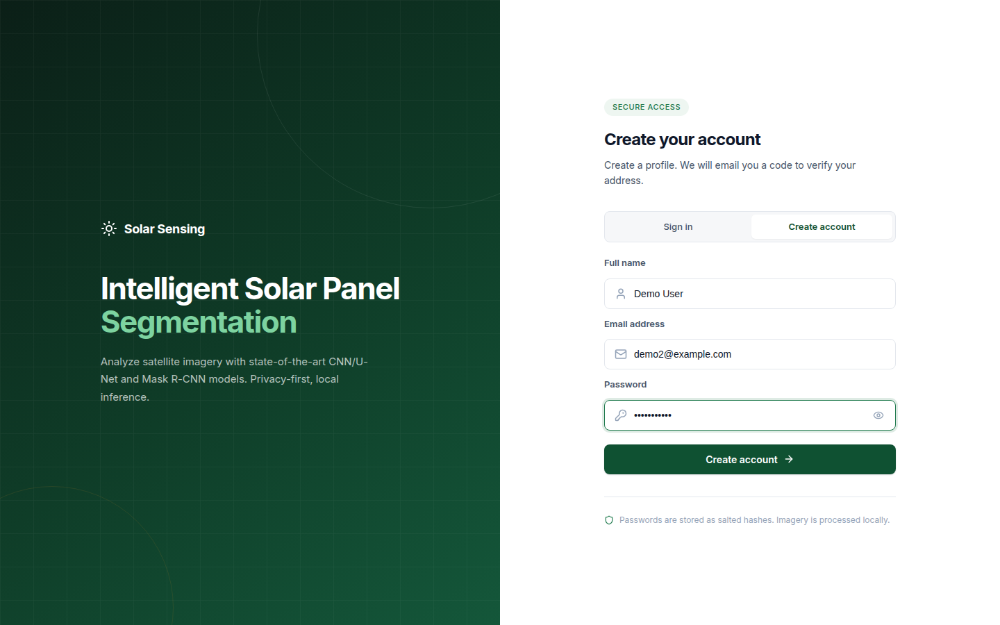
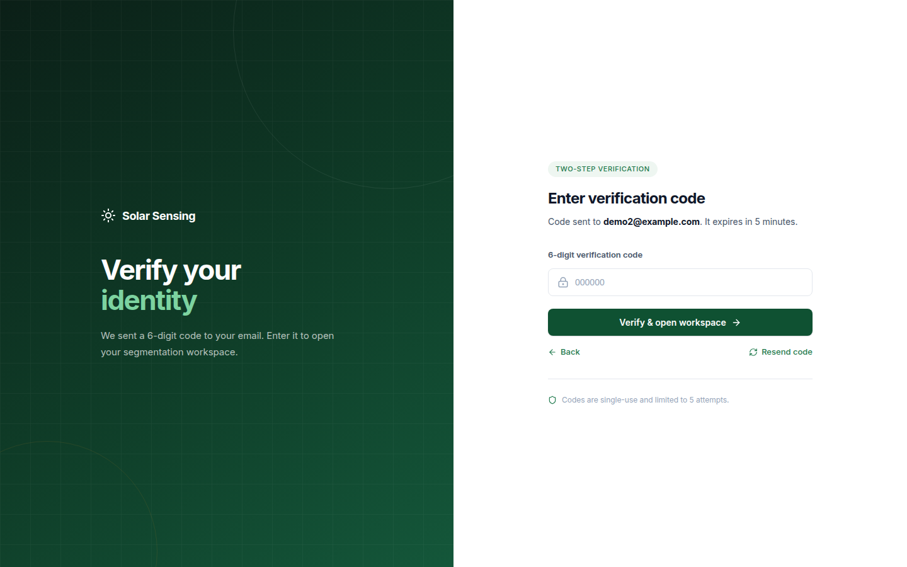
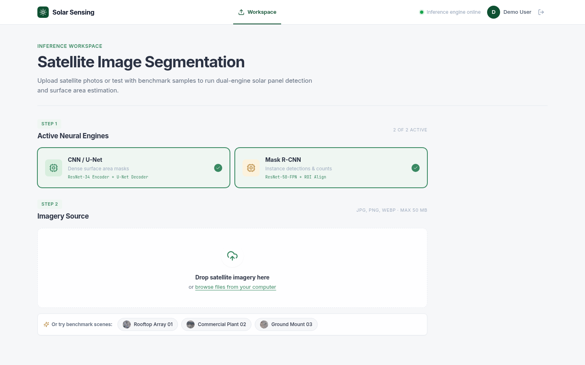
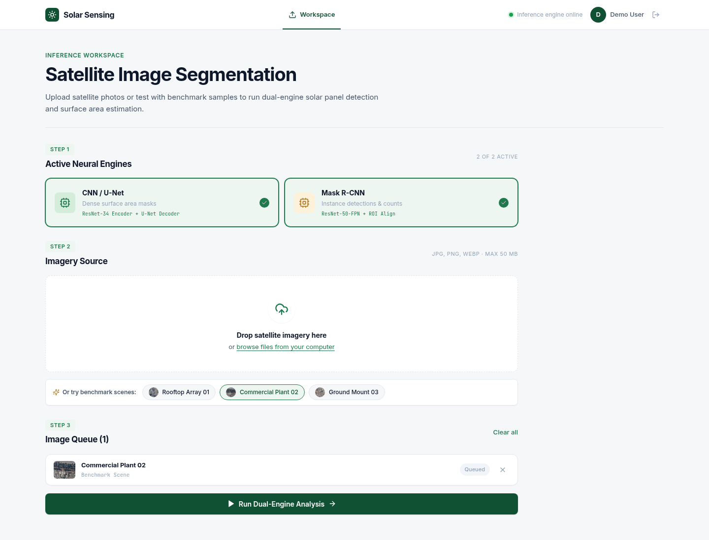
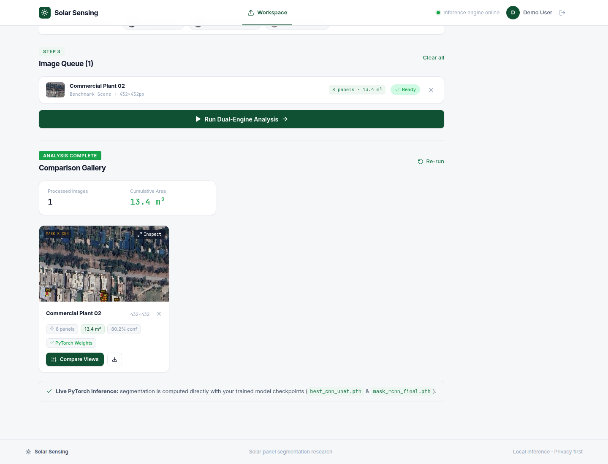
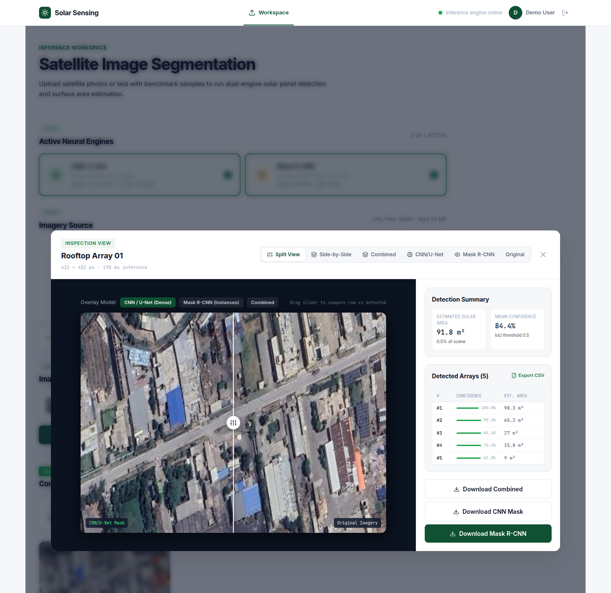
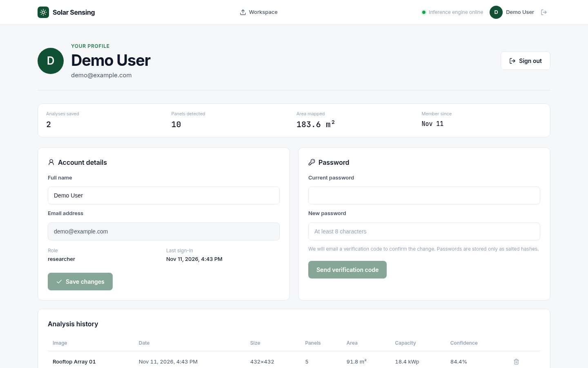

# Solar Sensing

Automated monitoring of distributed solar energy on Pakistan's urban flat roofs.
The project detects and measures rooftop solar panels in satellite imagery using
two models (a CNN/U-Net and a Detectron2 Mask R-CNN), served through a Python
API and a React web application.

## Repository Structure

```text
.
├── backend/                  # Python inference API (no UI code)
│   ├── server.py             #   HTTP API: auth, OTP, inference, history
│   ├── db.py                 #   SQLite storage (users, sessions, analyses)
│   ├── otp_service.py        #   Email one-time-code service
│   ├── cnn_model.py          #   U-Net model, dataset and transforms
│   └── models/               #   Trained checkpoints (Git LFS)
├── frontend/                 # React + Vite + TypeScript web app (UI only)
│   ├── src/
│   │   ├── pages/            #     Login, OTP, Workspace, Profile
│   │   ├── components/       #     Layout, image comparison modal
│   │   ├── context/          #     Auth state
│   │   └── utils/            #     Inference client
│   └── public/samples/       #     Sample satellite scenes
├── training/                 # Model training and evaluation
│   ├── data/                 #   Multi-temporal (2021–2025) dataset
│   ├── notebooks/            #   CNN and Mask R-CNN notebooks
│   ├── scripts/              #   train_* / evaluate_* entry points
│   └── results/              #   Training outputs and archives
├── tests/                    # Backend unit and API tests
├── legacy/streamlit_app.py   # Original Streamlit interface (superseded)
├── scripts/                  # install.sh, run.sh
├── docs/figures/             # Evaluation and test-case tables for reports
├── data/                     # Local SQLite database (created at runtime)
├── requirements.txt          # Python dependencies
├── .env.example              # Environment template
└── README.md
```

## Quick Start

```bash
./scripts/install.sh      # Python dependencies, PyTorch, Detectron2
cd frontend && npm install && cd ..
cp .env.example .env      # then fill in SMTP settings (see below)
./scripts/run.sh          # API on :8000 and web app on :5173
```

Open <http://localhost:5173>.

## Frontend

The web app lives in [`frontend/`](frontend) and is built with React 18,
TypeScript, Vite and React Router. It talks to the backend over HTTP and
contains no model code.

| Screen | Purpose |
| --- | --- |
| Login / Sign up | Email and password account creation with email OTP verification |
| OTP | Six-digit code entry, resend and expiry handling |
| Workspace | Upload imagery, pick CNN/U-Net, Mask R-CNN or both, run analysis, view area and panel counts |
| Image comparison | Split-view slider, side-by-side view, combined overlay, CSV and image download |
| Profile | Display name, password change, analysis history |

### How it works

The screenshots below were captured from the running app with the real CNN/U-Net
and Mask R-CNN checkpoints loaded.

**1. Sign in or create an account.** New users pick *Create account*; returning
users sign in with email and password. Passwords are stored as salted hashes.




**2. Verify your email.** A six-digit code is emailed to you. It expires after
five minutes, is single-use, and is limited to five attempts. Use *Resend code*
if it does not arrive. (With no SMTP settings, the code is printed in the
backend log instead, which is handy for local development.)



**3. Open the workspace and choose your models.** Step 1 selects CNN/U-Net
(dense surface-area masks), Mask R-CNN (instance detections and counts), or
both. Step 2 is the imagery source: drag in JPG, PNG or WebP files (up to
50 MB), browse for them, or click one of the benchmark scenes.



**4. Queue images and run the analysis.** Each queued image shows a thumbnail
and size. Press *Run Dual-Engine Analysis* to send the queue to the backend.



**5. Read the results.** The comparison gallery shows, per image, the number of
panels, estimated solar area in m², mean confidence and the model checkpoints
used, plus totals across the whole queue.



**6. Inspect a result.** *Compare Views* opens the inspection view: drag the
slider to compare the original imagery against the model overlay, or switch to
side-by-side, combined, CNN-only, Mask R-CNN-only and original views. The table
lists each detected array with its confidence and area; export it as CSV or
download the combined image, CNN mask or Mask R-CNN overlay.



**7. Review your history.** The profile page keeps a running total of analyses,
panels detected and area mapped, lets you rename your account or change your
password (confirmed by email code), and lists every saved analysis with the
option to delete it.



### Running the frontend

Run it on its own:

```bash
cd frontend
npm install
npm run dev        # http://localhost:5173
npm run build      # type-check and production build into frontend/dist
npm run preview    # serve the production build
```

The frontend reads the API address from `VITE_API_URL` and defaults to
`http://localhost:8000`. To point it elsewhere, create `frontend/.env.local`:

```bash
VITE_API_URL=https://your-api-host
```

If the backend is not reachable, the workspace falls back to a client-side
preview mode that does not run the real models.

## Backend

Run the API from the repository root:

```bash
python3 -m backend.server        # http://localhost:8000
```

It loads `backend/models/best_cnn_unet.pth` and
`backend/models/mask_rcnn_final.pth`, and stores accounts and analysis history
in `data/solar_sensing.db` (override with `SOLAR_DB_PATH`).

Tests:

```bash
python3 -m unittest discover -s tests -t .
```

### Email OTP

Sign-up and password changes are confirmed with a six-digit code sent by email.
Codes expire after five minutes by default and are compared in constant time.
Configure SMTP in `.env` (copy it from `.env.example`); `scripts/run.sh` loads
it automatically:

| Variable | Meaning |
| --- | --- |
| `SMTP_SERVER`, `SMTP_PORT` | Mail server (default `smtp.gmail.com:587`) |
| `SMTP_USERNAME`, `SMTP_PASSWORD` | Sender account and Gmail App Password |
| `FROM_EMAIL` | Sender address |
| `OTP_EXPIRY_MINUTES` | Code lifetime |

Never commit `.env` or real credentials.

## Training and Evaluation

Detectron2 must be installed in a PyTorch-compatible environment (done by
`scripts/install.sh`). Run these from the repository root:

```bash
python -m training.scripts.train_cnn
python -m training.scripts.evaluate_cnn

python -m training.scripts.train_mask_rcnn
python -m training.scripts.evaluate_mask_rcnn
```

Default evaluation checkpoints are `backend/models/best_cnn_unet.pth` and
`backend/models/mask_rcnn_final.pth`. Use `--device cpu` without CUDA. On a 6 GB
GPU, train Mask R-CNN with a small batch:

```bash
python -m training.scripts.train_mask_rcnn --batch-size 1 --workers 0
```

## Legacy Streamlit Interface

The original single-file interface is kept for reference:

```bash
streamlit run legacy/streamlit_app.py
```
